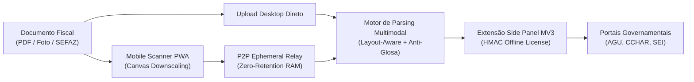

# ⚡ doc2fill — Captura Inteligente & Autofill Governamental com Zero Retenção

[](https://developer.chrome.com/docs/extensions/mv3/intro/)
[](https://python.org)
[](https://www.typescriptlang.org)
[]()
[]()
[]()
[](LICENSE)
[]()

> **Elimine o trabalho braçal de digitação fiscal em portais públicos com privacidade absoluta.**  
> O `doc2fill` automatiza a captura, parsing inteligente (PDF, fotos térmicas, Chave SEFAZ 44 dígitos) e injeção em formulários complexos (AGU, SEI, SIAFI, CCHAR) sem salvar nenhum dado em banco de dados na nuvem.

---

## ⚡ Quickstart

```bash
# 1. Clonar o repositório
git clone https://github.com/kazuhirokamim/doc2fill.git
cd doc2fill

# 2. Instalar dependências
npm install

# 3. Rodar suíte completa de testes (210 testes verdes)
npm test

# 4. Iniciar servidor de demonstração local
npm start
```

Acesse o simulador CCHA e portal de testes em `http://localhost:3333/portal`.

---

## 🏛️ Arquitetura do Sistema



---

## 🚀 Diferenciais de Engenharia

- **Zero Retenção de Dados (100% LGPD):** Nenhuma imagem, documento ou dado de contribuinte é salvo em banco de dados ou enviado para servidores terceiros. Ciclo de vida efêmero na RAM com expurgo automático em 5 minutos.
- **Side Panel Nativo Manifest V3:** Operação sob demanda sem injeção residual no DOM da página web governamental.
- **Motor Anti-Glosa & Decodificador SEFAZ:** Mapeamento automático de procedimentos médicos/fiscais e decodificação determinística de chaves de 44 dígitos.
- **Licenciamento Offline HMAC-SHA256:** Funciona perfeitamente em ambientes governamentais fechados (*air-gapped*) sem necessidade de conexão com nuvem para validar assinaturas.
- **Pipeline Óptico & Upscaling Adaptativo:** Ampliação automática em Canvas e estiramento de contraste para leitura de cupons de baixa resolução e PDFs escaneados com Zero Retenção.
- **Qualidade Rigorosa (Tear / Noesis):** 237 testes unitários e de integração verdes e 100% de precisão em documentos heterogêneos reais.

---

## 📁 Estrutura do Monorepo

```
doc2fill/
├── core/                           # Parsing multimodal, validações e motor anti-glosa
├── extension/                      # Extensão Manifest V3 com Side Panel nativo
├── mobile-pwa/                     # Scanner mobile com relay P2P e canvas downscaling
├── demo-portal/                    # Simulador de portal CCHA / AGU
├── documentation/                  # Laudo pericial, artigo IEEE/SBC e vitrine
├── docs/                           # ADRs (ADR-001 a ADR-027) e planos SDD
└── tests/                          # 210 testes automatizados
```

---

## 📜 Licença

Distribuído sob a licença **MIT**.
