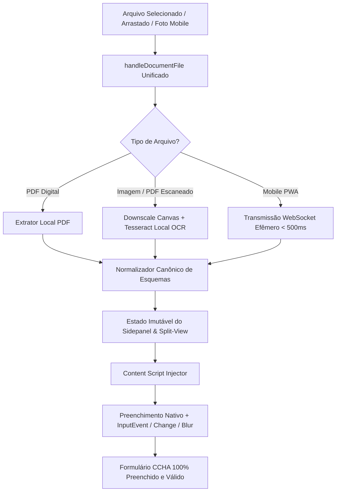

# ⚡ MASTER PLAN DOC2FILL — ROADMAP DE ENGENHARIA DE 3 SEMANAS (MVP) & MONETIZAÇÃO Q4/2026

**Documento Estratégico & Técnico de Execução Ágil (Kazuhiro & Lucas)**  
**Versão:** 2.0.0 (Unificação do Plano Executivo de Monetização com o Diagnóstico do Pipeline Técnico)  
**Governança:** Metodologia Scrum Semanal + Kanban Rígido (WIP Limits & Regra de 1 Dia por Tarefa)  
**Orquestração:** Modo Maestro Tear & Swarm de Especialistas Noesis Ativos  
**Meta Suprema:** MVP localmente estável e infalível em **3 semanas** (21 dias), viabilizando tração comercial e faturamento até o encerramento de 2026.

---

## 1. Diagnóstico do Abismo: "Sonho de Venda vs. Realidade de Engenharia"

### 1.1. O Choque de Realidade
O documento comercial original (*Master Plan Executivo Q4/2026*) projetava faturamento de **R$ 43.769,00** e lucro líquido de **R$ 38.839,00** até dezembro, baseado na premissa de venda de assinaturas de R$ 197,00/mês para procuradores do CCHA e clínicas. 

Entretanto, como constatado clinicamente na realidade do repositório:
> *"Esse planejamento comercial está fora de cogitação no momento porque o produto ainda não está minimamente pronto e estável para testes locais — quem dirá para venda."*

Tentar comercializar um produto cujo autofill falha silenciosamente, que não reage a arrastos de arquivos locais, que perde chaves de formulário ou que depende de um servidor local instável destruiria a reputação da solução no primeiro dia de teste com os clientes parceiros.

### 1.2. O Diagnóstico Técnico Forense (Causas Raízes do PDF Técnico)
A análise profunda do comportamento do motor identificou os 4 pontos de quebra do pipeline:
1. **Descompasso entre Drag-and-Drop e Input Nativo:** O evento `onDrop` executa `e.preventDefault()`, captura `dataTransfer.files[0]`, mas perde o acoplamento com o listener reativo do `onChange` e do pipeline assíncrono.
2. **Mutação Direta de Estado sem Reatividade:** Atribuições imperativas diretas nos objetos de formulário não disparam o ciclo de detecção de mudanças em páginas modernas (Angular, React, Vue), mantendo o DOM desatualizado.
3. **Discrepância Estrutural de Chaves:** O OCR e os parsers brutos retornam campos heterogêneos (`nr_documento`, `cnpj_prestador`, `vlr_total`), enquanto os formulários de destino (como o portal CCHA) exigem chaves e seletores canônicos específicos (`#numero_documento`, `#cpf_cnpj`, `#valor_total`). Sem uma camada determinística de tradução de esquema, os valores se perdem silenciosamente.
4. **Bloqueio de Eventos Nativos no DOM:** Atribuir `input.value = x` diretamente pelo JavaScript não aciona os manipuladores de eventos reativos do framework da página. Se os eventos `input` e `change` não forem despachados com `bubbles: true` e `composed: true`, os valores somem assim que o usuário clica em outro campo ou no botão de submissão.

---

## 2. Padrão de Correção Arquitetural Unificado (Padrão Maestro)

Toda a arquitetura do Doc2Fill é consolidada sob o **Padrão Unificado de Processamento e Preenchimento Reativo Local-First (Zero-Retention)**:



### O Padrão de Injeção no DOM Destino:
```javascript
// Disparo forçado de eventos nativos para frameworks reativos (Angular / React / Vue)
function setInputValueWithEvents(input, value) {
  const previousValue = input.value;
  const prototype = Object.getPrototypeOf(input);
  const descriptor = Object.getOwnPropertyDescriptor(prototype, 'value');
  
  if (descriptor && descriptor.set) {
    descriptor.set.call(input, value);
  } else {
    input.value = value;
  }

  // 1. Evento de Input (com inputType insertText)
  input.dispatchEvent(new InputEvent('input', {
    bubbles: true,
    cancelable: true,
    composed: true,
    data: value,
    inputType: 'insertText'
  }));

  // 2. Evento de Change
  input.dispatchEvent(new Event('change', { bubbles: true, composed: true }));

  // 3. Evento de Blur para acionar validações 'touched'
  input.dispatchEvent(new Event('blur', { bubbles: true, composed: true }));
}
```

---

## 3. Matriz de Escopo Rígido de MVP (Trade-off Estrutural)

Para assegurar entrega real em 3 semanas, aplicamos o filtro cirúrgico do que é vital para venda e o que é empurrado para a V2:

| Funcionalidade / Recurso | Escopo Obrigatório do MVP (3 Semanas) | Fica para a V2 (Pós-Validação Comercial) |
| :--- | :--- | :--- |
| **Entrada de Arquivos** | Clique e drag-and-drop de JPG, PNG e PDF com feedback visual claro. | Suporte a formatos exóticos (TIFF, BMP legados, arquivos compactados ZIP). |
| **Motor OCR & Parsing** | 8 campos essenciais (Tipo, CNPJ/CPF, Razão, Número, Data, Valor, Descritivo, Motivo). | Reconhecimento universal de dezenas de certidões judiciais raras. |
| **Preenchimento** | Preenchimento reativo automático instantâneo com eventos nativos forçados. | Animações complexas de digitação visual ou micro-interações supérfluas. |
| **Interface do Operador** | Split-view lado a lado (visualização da foto + campos editáveis) com edição manual. | Histórico persistente de alterações e trilha de auditoria multi-usuário. |
| **Sincronização Mobile** | PWA leve via QR Code para escanear com a câmera do celular e enviar via relay local. | App nativo para iOS/Android publicado em lojas oficiais (Apple/Google). |
| **Anti-Glosa & Regras** | Validação sintática e sugestão legal básica fundamentada na Lei 13.327/2016. | Motor semântico preditivo baseado em IA gerativa em nuvem. |
| **Gestão de Acesso** | Licenciamento simples via chave local com decremento de quota em SQLite local. | RBAC complexo, múltiplos papéis hierárquicos e SSO corporativo (SAML/OAuth). |

---

## 4. Governança Ágil: Scrum Semanal com Kanban Rígido

### 4.1. As 4 Colunas do Fluxo de Trabalho
1. **A Fazer (Sprint Backlog):** Máximo de 5 a 6 tarefas atômicas por sprint semanal.
2. **Em Desenvolvimento:** **WIP Limit = 1 tarefa por vez**. Foco total sem dispersão.
3. **Em Teste / Validação (QA & Lanes Tear):** **WIP Limit = 2 tarefas paralelas**. Auditoria adversarial de testes e integridade de código.
4. **Concluído (Definition of Done):** Tarefa aprovada com testes verdes, documentos reais validados e sem regressão.

### 4.2. Regra de Ouro da Tarefa Diária
> **Nenhuma tarefa pode ter duração superior a 1 dia útil (orçamento de 2 a 4 horas por tarefa).**  
> É terminantemente proibido criar cartões abstratos como "Criar formulário" ou "Arrumar OCR". Toda tarefa deve ser fatiada em uma unidade funcional testável com entrada, processamento, saída e teste associado.

### 4.3. Protocolo de Estagnação (Regra das 3 Horas)
Se um bloqueio ou bug técnico persistir sem solução clara por **mais de 3 horas**, é proibido insistir em círculos no mesmo código. O desenvolvedor/agente deve obrigatoriamente:
- Isolar a causa raiz em script scratch minimalista com breakpoints ou logs cirúrgicos no console;
- Se o bloqueio for externo ou de dependência, implementar fallback seguro e documentado;
- Escalar imediatamente para decisão arquitetural (ADR).

---

## 5. Cronograma de Execução: Os 3 Sprints Semanais (15 Dias Úteis)

```
┌──────────────────────────────────────────────────────────────────────────────────┐
│                   ROADMAP DE 3 SEMANAS DOC2FILL (SCRUM & KANBAN)                 │
├────────────────────┬─────────────────────────────────────────────────────────────┤
│ SPRINT             │ META SUPREMA & ENTREGÁVEL DETERMINÍSTICO                     │
├────────────────────┼─────────────────────────────────────────────────────────────┤
│ Semana 1 (Sprint 1)│ Resolução do Core, Drag-and-Drop & Pipeline Funcional        │
│                    │ Meta: "Foto/PDF arrastado = 8 campos extraídos e exibidos"  │
├────────────────────┼─────────────────────────────────────────────────────────────┤
│ Semana 2 (Sprint 2)│ Experiência E2E, Split-View & Autofill no Navegador         │
│                    │ Meta: "Botão Preencher aciona o portal com eventos nativos" │
├────────────────────┼─────────────────────────────────────────────────────────────┤
│ Semana 3 (Sprint 3)│ Estabilização Mobile, Teste Cego com 20 Notas & Go-to-Market│
│                    │ Meta: "Produto blindado, vídeo demo gravado e vendas ativas"│
└────────────────────┴─────────────────────────────────────────────────────────────┘
```

---

### 📅 SPRINT 1 (Semana 1) — Resolução do Core & Pipeline Funcional
**Objetivo do Sprint:** Eliminar todas as falhas de upload, parsing e sincronização de dados no Sidepanel.

#### Quadro Kanban da Semana 1:

| ID | Dia | Tarefa Atômica (2 a 4h) | Subagente Especialista | Critério de Aceite (Definition of Done) | Status |
| :--- | :--- | :--- | :--- | :--- | :--- |
| **S1-T1** | Dia 1 (Seg) | **Unificação do Handler de Upload (`handleDocumentFile`):** Unificar os fluxos de `onDrop` e `onChange`, capturar arquivo com segurança e exibir logs estruturados de validação. | `noesis-frontend-maestro` / `tear-frontend` | Arrastar ou selecionar JPG, PNG e PDF aciona o mesmo handler sem quebrar a cadeia assíncrona. | A Fazer |
| **S1-T2** | Dia 2 (Ter) | **Normalizador Canônico de Esquemas (`core/document-parser.js`):** Mapear todas as saídas de OCR e PDF para os 8 campos canônicos (`tipo_documento`, `cpf_cnpj`, `fornecedor`, `numero_documento`, `data`, `valor`, `descritivo`, `motivo`). | `noesis-backend-maestro` / `tear-backend` | Objeto de saída possui chaves uniformes e imutáveis, eliminando campos nulos ou indefinidos. | A Fazer |
| **S1-T3** | Dia 3 (Qua) | **Feedback Visual & Estados de Carregamento:** Implementar loading spinner, barra de progresso visual de OCR e bloqueio de novos uploads durante o processamento. | `noesis-frontend-maestro` / `tear-frontend` | Usuário visualiza com clareza o estado de leitura ("Lendo PDF...", "Executando OCR...") sem travamento de UI. | A Fazer |
| **S1-T4** | Dia 4 (Qui) | **Tratamento de Exceções & Sanitização de Imagens:** Sanitizar imagens corrompidas, arquivos ilegíveis ou timeouts de OCR com mensagens claras e amigáveis ao usuário. | `noesis-error-path-inquisitor` / `tear-qa` | Arquivos com ruído extremo ou sem texto exibem alerta amigável sem lançar exceções não tratadas no console. | A Fazer |
| **S1-T5** | Dia 5 (Sex) | **Suíte TDD de Integração Local & Fechamento da Sprint 1:** Testar o ciclo completo em ambiente local com 10 arquivos reais (PDFs e cupons fiscais). | `noesis-qa-maestro` / `tear-qa` | 10 arquivos de teste processados com sucesso no Sidepanel com 100% dos testes da Sprint 1 verdes. | A Fazer |

---

### 📅 SPRINT 2 (Semana 2) — Experiência E2E, Split-View & Injeção Reativa
**Objetivo do Sprint:** Garantir que os dados do Sidepanel preencham o portal de destino instantaneamente e permitam edição manual fluida.

#### Quadro Kanban da Semana 2:

| ID | Dia | Tarefa Atômica (2 a 4h) | Subagente Especialista | Critério de Aceite (Definition of Done) | Status |
| :--- | :--- | :--- | :--- | :--- | :--- |
| **S2-T1** | Dia 6 (Seg) | **Split-View & Visualização Lado a Lado no Sidepanel:** Renderizar thumbnail/preview do documento original ao lado dos 8 campos para conferência visual imediata. | `noesis-bento-tactile-designer` / `tear-frontend` | Usuário enxerga a foto do cupom/NF ao lado dos campos preenchidos, permitindo checagem rápida. | A Fazer |
| **S2-T2** | Dia 7 (Ter) | **Edição Manual & Fallback Desbloqueado:** Permitir que qualquer campo seja livremente alterado ou corrigido pelo usuário no Sidepanel sem quebrar as máscaras. | `noesis-frontend-maestro` / `tear-frontend` | Edição manual de CNPJ, Data ou Valor atualiza o payload sem disparar revalidações bloqueantes. | A Fazer |
| **S2-T3** | Dia 8 (Qua) | **Injetor de Eventos Reativos no Content Script (`extension/content.js`):** Implementar injeção com prototype setter e eventos compostos (`InputEvent`, `change`, `blur`). | `noesis-frontend-maestro` / `tear-frontend` | Autofill preenche formulários Angular Material / CCHA e os campos permanecem salvos após clique fora. | A Fazer |
| **S2-T4** | Dia 9 (Qui) | **Mapeador Semântico Avançado de Selects:** Correspondência tolerante a variações para opções de tipo de documento (NFC-e, NFS-e, Recibo, Guia TISS). | `noesis-domain-core` / `tear-backend` | Qualquer variação textual de nota fiscal seleciona a opção correspondente sem resetar o `<select>`. | A Fazer |
| **S2-T5** | Dia 10 (Sex) | **Sprint Review Técnica & Bateria E2E:** Simulação de ponta a ponta no portal de demonstração CCHA com congelamento da base de código do MVP. | `noesis-reviewer-maestro` / `tear-code-reviewer` | Gravação de teste local validada com 0 erros de injeção e 0 colisões de campos. | A Fazer |

---

### 📅 SPRINT 3 (Semana 3) — Sincronização Mobile, Teste de Estresse & Go-to-Market
**Objetivo do Sprint:** Validar o scanner mobile PWA via QR Code, submeter 20 documentos reais e preparar os ativos de venda.

#### Quadro Kanban da Semana 3:

| ID | Dia | Tarefa Atômica (2 a 4h) | Subagente Especialista | Critério de Aceite (Definition of Done) | Status |
| :--- | :--- | :--- | :--- | :--- | :--- |
| **S3-T1** | Dia 11 (Seg) | **Otimização do PWA Mobile (`mobile-pwa/`):** Auto-foco na câmera do celular, compressão no Canvas (< 300KB) e transmissão via WebSocket em < 500ms. | `noesis-system-io-runtime` / `tear-backend` | Foto tirada no smartphone chega ao computador e preenche o Sidepanel em menos de 1 segundo. | A Fazer |
| **S3-T2** | Dia 12 (Ter) | **Bateria de Estresse com 20 Comprovantes Fiscais Reais:** Teste cego com cupons amassados de farmácia, notas de posto de gasolina e DANFEs A4 escaneados. | `noesis-saci-hunter` / `tear-qa` | Assertividade superior a 90% nos 8 campos essenciais sem travamentos ou falhas de memória. | A Fazer |
| **S3-T3** | Dia 13 (Qua) | **Gravação do Ativo Demo Comercial (Vídeo de 30 a 45s):** Gravação de alta fidelidade sem cortes mostrando: Foto tirada no celular -> Preenchimento no CCHA em 6 segundos. | `hermes-creative-director` / `tear-brand-architect` | Vídeo MP4 gravado com clareza cristalina, áudio limpo e foco no ganho de tempo imediato. | A Fazer |
| **S3-T4** | Dia 14 (Qui) | **Empacotamento do Closed Beta (.zip) & Landing Page de Demonstração:** Criação do pacote de distribuição rápida da extensão para early adopters e página de agendamento. | `hermes-conversion-psych` / `tear-web-designer` | Arquivo `.zip` pronto para instalação guiada em 2 cliques e página de captura ativa. | A Fazer |
| **S3-T5** | Dia 15 (Sex) | **Kick-off de Vendas Diretas & Início da Prospecção Ativa:** Apresentação da solução para os primeiros 5 a 10 advogados/procuradores parceiros. | `tear-product-owner` / `hermes-traffic-arbitrage` | Primeiras reuniões de demonstração ao vivo realizadas com base no produto real validado. | A Fazer |

---

## 6. Critérios de Prontidão Comercial (Definition of Done Final)

Antes de qualquer abordagem de venda, a solução deve cumprir o **Checklist Inegociável de Prontidão**:
- [ ] O fluxo de arrastar imagem/PDF, processar o OCR e visualizar os 8 campos no Sidepanel roda em < 3 segundos localmente.
- [ ] O clique em "Preencher Automaticamente no CCHA" preenche todos os campos correspondentes no portal ativo sem sumir após o clique do mouse.
- [ ] O usuário consegue editar manualmente qualquer dado incorreto no Sidepanel antes de disparar o autofill.
- [ ] O scanner mobile via QR Code conecta em < 500ms na rede local e transmite a imagem tratada com sucesso.
- [ ] Suíte de testes automatizados com cobertura > 80% e zero testes falhando (`npm test` 100% verde).
- [ ] Vídeo demonstrativo de 30 a 45 segundos disponível para envio aos leads qualificados.

---

## 7. Como Este MVP Conecta com a Meta Financeira de Dezembro

Ao consolidar o produto técnico nas próximas 3 semanas, abrimos caminho para a execução imediata das campanhas de receita nos meses de Novembro e Dezembro:

```
[Semanas 1 a 3: Outubro] -> MVP Técnico Infalível & 5 Primeiros Clientes Piloto (R$ 985 MRR)
           │
           ▼
[Semanas 4 a 7: Novembro] -> Tração CCHA, Outreach Ativo & Submissão Chrome Web Store
           │
           ▼
[Semana 8: Black Friday] -> Oferta de Anuidade à Vista no Pix (R$ 19.800 de Caixa Imediato)
           │
           ▼
[Semanas 9 a 13: Dezembro]-> Escala, Clínicas Enterprise & Consolidação do Lucro Líquido (> R$ 38.000)
```

O sucesso do negócio em dezembro depende exclusivamente da perfeição técnica alcançada nestas 3 primeiras semanas. O foco é execução cirúrgica, sem desvios e com disciplina absoluta de engenharia.
