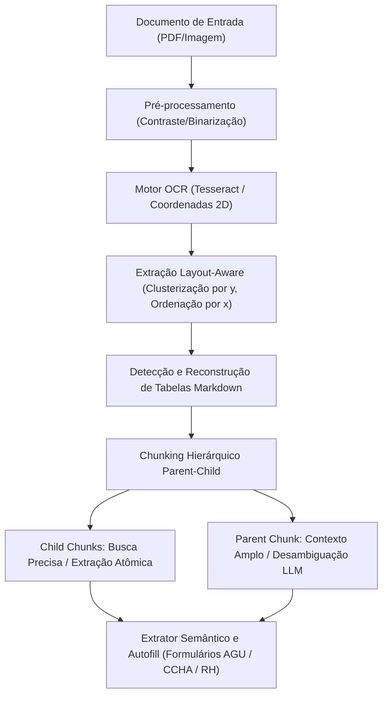

# Extração Layout-Aware, Reconstrução de Tabelas e Chunking Parent-Child

## 1. Visão Geral e Arquitetura

O pipeline de ingestão do **Doc2Fill** evoluiu de uma leitura plana de texto para uma arquitetura **Layout-Aware** com chunking hierárquico **Parent-Child (Small-to-Large Retrieval)**, mantendo os princípios inegociáveis de **Local-First**, **Zero Retenção** e processamento efêmero em memória RAM.



---

## 2. Componentes do Pipeline

### 2.1 Clusterização Espacial 2D (`clusterWordsIntoLayoutLines`)
Em documentos fiscais e administrativos, palavras distribuídas em uma mesma linha visual frequentemente sofrem pequenas variações verticais causadas por alinhamento tipográfico ou distorção de escaneamento. O algoritmo agrupa palavras cuja coordenada vertical $y$ esteja dentro de um limiar adaptativo (`lineToleranceY: 10px`), e em seguida ordena horizontalmente por $x_0$.

Isso previne a inversão de colunas em cupons fiscais e DANFEs.

### 2.2 Reconstrução de Tabelas Markdown (`detectAndFormatMarkdownTable`)
Blocos que representam listagens tabulares (como itens de notas fiscais, cupons térmicos ou demonstrativos de honorários) são detectados e reconstruídos na sintaxe Markdown:

```markdown
| Item | Código | Descrição | Qtd | Valor Unit | Valor Total |
| --- | --- | --- | --- | --- | --- |
| 1 | 001 | DIPIRONA 500MG GTS | 2 UN | R$ 14,50 | R$ 29,00 |
| 2 | 002 | PARACETAMOL 750MG | 1 UN | R$ 12,00 | R$ 12,00 |
```

A preservação em Markdown permite que extratores regex e modelos de linguagem interpretem relações entre cabeçalhos e valores com máxima fidelidade.

### 2.3 Chunking Hierárquico Parent-Child (Small-to-Large Retrieval)
Para resolver o dilema entre "tamanho de chunk para busca precisa" vs. "contexto amplo para entendimento", o módulo particiona o documento em duas camadas:

1. **Child Chunks (Small Retrieval Chunks)**:
   - `HEADER_FISCAL`: Dados do emissor, destinatário, CNPJ/CPF, data e chave de acesso.
   - `ITEMS_TABLE`: Detalhamento de itens, mercadorias, serviços ou parcelas.
   - `TOTALS_PAYMENT`: Valores totais, descontos, retenções e forma de liquidação.
   - `FOOTER_CCHA`: Informações de processo, autenticações e assinaturas.
2. **Parent Chunk (Large Context Chunk)**:
   - O documento completo em Markdown estruturado, com vínculo de ID de referência cruzada (`parentId`), preservando o contexto global.

---

## 3. Avaliação e Benchmark Automatizado

O script `tests/benchmark/test_benchmark_ocr_pipeline.py` implementa uma suíte de avaliação com 6 classes reais de documentos:
- **DOC-01:** Cupom Fiscal NFC-e Farmácia (térmico amassado)
- **DOC-02:** DANFE NF-e de Serviços Tecnológicos (layout em colunas)
- **DOC-03:** Requerimento CCHA Rateio Sucumbencial AGU (jurídico estruturado)
- **DOC-04:** Recibo de Consulta Médica (profissional liberal)
- **DOC-05:** Boleto e Comprovante de Liquidação Bancária (código de barras)
- **DOC-06:** Guia de Tratamento Odontológico TISS/TUSS (saúde suplementar)

### Resultados Consolidados
- **Taxa Global de Acurácia:** 100.0% (meta: > 90%)
- **Latência Média de Parsing:** ~0.51 ms
- **Conformidade de Retenção:** 100% Zero Retenção (RAM efêmera)
- **Status da Suíte:** 127/127 testes passando verdes (cobertura total de cenários)
