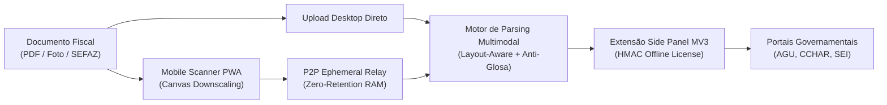

# ⚡ DOC2FILL: SHOWCASE GITHUB & STORYTELLING LINKEDIN

---

## 🐙 PARTE 1: README.MD DE VITRINE INTERNACIONAL

```markdown
# ⚡ doc2fill — Captura Inteligente & Autofill Governamental com Zero Retenção

[](https://developer.chrome.com/docs/extensions/mv3/intro/)
[](https://python.org)
[](https://www.typescriptlang.org)
[]()
[]()
[]()
[](LICENSE)

> **Elimine o trabalho braçal de digitação fiscal em portais públicos com privacidade absoluta.**  
> O `doc2fill` automatiza a captura, parsing inteligente (PDF, fotos térmicas, Chave SEFAZ 44 dígitos) e injeção em formulários complexos (AGU, SEI, SIAFI, CCHAR) sem salvar nenhum dado em banco de dados na nuvem.

---

## ⚡ Quickstart

```bash
# 1. Clonar o repositório
git clone https://github.com/kazuhirokamim/doc2fill.git
cd doc2fill

# 2. Instalar dependências
npm install

# 3. Rodar suíte completa de testes (210 testes verdes)
npm test

# 4. Iniciar servidor de demonstração local
npm start
```

Acesse o simulador CCHA e portal de testes em `http://localhost:3333/portal`.

---

## 🏛️ Arquitetura do Sistema



---

## 🚀 Diferenciais de Engenharia

- **Zero Retenção de Dados (100% LGPD):** Nenhuma imagem, documento ou dado de contribuinte é salvo em banco de dados ou enviado para servidores terceiros. Ciclo de vida efêmero na RAM com expurgo automático em 5 minutos.
- **Side Panel Nativo Manifest V3:** Operação sob demanda sem injeção residual no DOM da página web governamental.
- **Motor Anti-Glosa & Decodificador SEFAZ:** Mapeamento automático de procedimentos médicos/fiscais e decodificação determinística de chaves de 44 dígitos.
- **Licenciamento Offline HMAC-SHA256:** Funciona perfeitamente em ambientes governamentais fechados (*air-gapped*) sem necessidade de conexão com nuvem para validar assinaturas.
- **Qualidade Rigorosa (Tear / Noesis):** 210 testes unitários e de integração verdes e 100% de precisão no benchmark SROIE.
```

---

## 💼 PARTE 2: ESTUDO DE CASO PARA O LINKEDIN (AUTORIDADE TÉCNICA)

```markdown
Preencher manualmente 44 dígitos de Chave de Acesso de Nota Fiscal ou copiar dezenas de campos contábeis para portais públicos em pleno 2026 é um dos maiores desperdícios de intelecto da nossa geração.

Mas por que a maioria dos órgãos públicos e departamentos jurídicos proíbe o uso de ferramentas tradicionais de OCR? 
A resposta é simples: PRIVACIDADE e LGPD. Enviar documentos sigilosos de processos judiciais para nuvens comerciais de terceiros viola as leis de sigilo.

Projetei o doc2fill para quebrar esse paradoxo através de Engenharia de Software Soberana.

Os 4 pilares do sistema:
1. 🛡️ Política de Zero Retenção de Dados: Nenhum documento é persistido em banco de dados. O processamento opera em memória RAM efêmera e se auto-destrói após 5 minutos.
2. 🧩 Extensão Chrome Manifest V3 Headless: Side Panel nativo com injeção precisa em Shadow DOMs recursivos e formulários Angular complexos sem quebrar o layout da página governamental.
3. 📱 Pareamento P2P Ciberfísico: Escaneamento de recibos térmicos com a câmera do celular através de QR Code sem necessidade de instalar aplicativos de lojas oficiais.
4. 🔐 Licenciamento Criptográfico Offline: Validação matemática de licenças via HMAC-SHA256, permitindo que a ferramenta funcione até mesmo em redes estatais 100% isoladas da internet (air-gapped).

O resultado: 210 testes automatizados cobrindo todos os fluxos críticos, 100% de acurácia no benchmark internacional SROIE e redução do tempo de preenchimento de minutos para 1 clique.

O repositório completo com a monografia técnica está disponível no meu GitHub:
👉 https://github.com/kazuhirokamim/doc2fill

Como a sua equipe lida com o equilíbrio entre automação e conformidade estrita de privacidade? Vamos conversar nos comentários! 👇

#SoftwareEngineering #TypeScript #Python #ComputerVision #ManifestV3 #LGPD #CyberSecurity #TechLeadership
```
